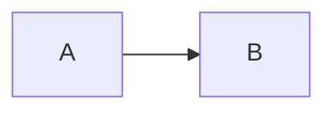

# comark-pele

[](https://npmx.dev/comark-pele)
[](https://npm.chart.dev/comark-pele)
[](https://github.com/farnabaz/comark-pele/actions/workflows/ci.yml)
[](https://github.com/farnabaz/comark-pele/blob/main/LICENSE)

Render Mermaid diagrams in [Comark](https://comark.dev) with
[Pele](https://pele.run), a small, fast renderer that outputs themeable SVG.

It works like Comark's built-in [mermaid plugin](https://comark.dev/plugins/built-in/mermaid):
the plugin turns ` ```mermaid ` code blocks into `pele` nodes, and a `Pele`
component draws them. There is a component for every Comark renderer:

| Renderer | Import | What it renders |
| -------- | ------ | --------------- |
| HTML     | `comark-pele/html`    | Inline SVG |
| Vue      | `comark-pele/vue`     | SVG on the server, responsive diagram with zoom in the browser |
| React    | `comark-pele/react`   | Same as Vue |
| Svelte   | `comark-pele/svelte`  | Same as Vue |
| Angular  | `comark-pele/angular` | Same as Vue |
| ANSI     | `comark-pele/ansi`    | The diagram source, since terminals can't show SVG |
| Markdown | `comark-pele`         | The original fenced code block |

## Install

```bash
pnpm add comark-pele
```

## Usage

Pass the plugin and the `Pele` component to your renderer.

### Vue

```vue
<script setup lang="ts">
import { Markdown } from '@comark/vue'
import pele, { Pele } from 'comark-pele/vue'
</script>

<template>
  <Suspense>
    <Markdown :components="{ Pele }" :plugins="[pele()]">{{ content }}</Markdown>
  </Suspense>
</template>
```

### React

```tsx
import { Markdown } from '@comark/react'
import pele, { Pele } from 'comark-pele/react'

<Markdown components={{ Pele }} plugins={[pele()]}>
  {content}
</Markdown>
```

### Svelte

```svelte
<script lang="ts">
  import { Markdown } from '@comark/svelte'
  import pele, { Pele } from 'comark-pele/svelte'
</script>

<Markdown value={content} components={{ Pele }} plugins={[pele()]} />
```

### Angular

```ts
import { Component } from '@angular/core'
import { Markdown } from '@comark/angular'
import pele, { Pele } from 'comark-pele/angular'

@Component({
  selector: 'app-root',
  imports: [Markdown],
  template: `<comark-markdown [value]="content" [plugins]="plugins" [components]="components" />`,
})
export class AppComponent {
  content = '```mermaid\nflowchart LR\n  A --> B\n```'
  plugins = [pele()]
  components = { Pele }
}
```

### HTML

```ts
import { createHtmlRenderer } from '@comark/html'
import pele, { Pele } from 'comark-pele/html'

const renderHtml = createHtmlRenderer({
  plugins: [pele()],
  components: { Pele },
})

const html = await renderHtml(content)
// <div class="pele-diagram" data-diagram="flowchart"><svg class="pele pele-flowchart" ...>...</svg></div>
```

To pass [Pele render options](https://pele.run/api#renderoptions), see
[Pele options](#pele-options).

### ANSI

```ts
import { createAnsiRenderer } from '@comark/ansi'
import pele, { Pele } from 'comark-pele/ansi'

const renderAnsi = createAnsiRenderer({ plugins: [pele()], components: { Pele } })
```

### Markdown

To write `pele` nodes back as fenced code blocks:

```ts
import { renderMarkdown } from 'comark/render'
import { Pele } from 'comark-pele'

const markdown = await renderMarkdown(tree, { components: { Pele } })
```

## The `pele` node

````markdown

````

parses to:

```ts
['pele', { class: 'wide', id: 'flow', language: 'mermaid', content: 'flowchart LR\n  A --> B\n' }]
```

Props on the opening fence are passed to the component, as with the mermaid plugin.

### Plugin options

```ts
pele({
  languages: ['mermaid', 'pele'], // code block languages turned into `pele` nodes
})
```

Using Comark's `mermaid` plugin as well? Give Pele its own language, for
example `pele({ languages: ['pele'] })`.

## Components

The Vue, React, Svelte and Angular components accept:

| Prop      | Description |
| --------- | ----------- |
| `content` | Diagram source. Set from the node. |
| `class`   | Extra classes for the wrapper. Set from fence props. |
| `options` | [Pele mount options](https://pele.run/api#mount), such as `zoom`, `icons`, `onRender`, or `fontSize`. |

On the server and on the first render they output the SVG from Pele's
`render()`, so diagrams show up without JavaScript. In the browser they
switch to Pele's `mount()`, which:

- fits the layout to the container width and redraws on resize,
- enables zoom when a diagram has to shrink,
- shows errors over the last diagram that rendered.

The wrapper is `div.pele-diagram`, with `data-diagram` set to the diagram type
and `data-error` set to the message when the source can't be drawn. Before
the browser takes over, an invalid diagram shows its source in `pre.pele-source`.

## Pele options

Every renderer that draws SVG exports `createPeleComponent(options)`, which
returns a `Pele` component with default [Pele options](https://pele.run/api#renderoptions):

```ts
import pele, { createPeleComponent } from 'comark-pele/vue'
// or 'comark-pele/html', '/react', '/svelte', '/angular'

const Pele = createPeleComponent({
  zoom: false,                  // no zoom controls
  fontSize: 14,
  autoDirection: false,         // keep `flowchart LR` horizontal on narrow screens
  icons: name => myIcons[name], // SVG for icons such as `fa:fa-car`
  onRender: result => console.log(result.type, result.links),
})
```

Then pass it like the default component: `components: { Pele }`. `Pele` itself
is `createPeleComponent()`.

- Call it once, outside templates and render functions, so the component
  type stays the same between renders.
- A component's own `options` prop is merged on top. `onRender` and
  `onError` from both are called.
- The HTML renderer only uses render options. `zoom`, `onRender` and
  `onError` apply in the browser, where the components use `mount()`.
- Mermaid settings such as themes go in the diagram itself, with frontmatter
  or a `%%{init}%%` directive.

## Theming

Pele styles diagrams with CSS variables. Changing them, for example for dark
mode, needs no re-render:

```css
.pele {
  --pele-bg: #fffcf0;
  --pele-fg: #100f0f;
  --pele-line: #100f0f;
  --pele-surface: #f2f0e5;
  --pele-border: #cecdc3;
  --pele-accent: #205ea6;
  --pele-font: system-ui, sans-serif;
}

.dark .pele {
  --pele-bg: #100f0f;
  --pele-fg: #cecdc3;
  --pele-line: #cecdc3;
  --pele-surface: #1c1b1a;
  --pele-border: #403e3c;
}
```

See [Pele theming](https://pele.run/theming) for all variables.

## Playground

```bash
pnpm play
```

Opens a two-column playground: edit markdown on the left, and pick a renderer
on the right (HTML, Vue, React, Svelte, Angular, ANSI, or Markdown). Under the
markdown, edit Pele options as JSON; they're passed to `createPeleComponent()`
and the renderer redraws. Each
renderer uses the real Comark `Markdown` component of its framework with
`comark-pele`, and is loaded only when selected. Use `?renderer=vue` in the URL
to open a specific one.

## Development

```bash
pnpm install
pnpm play       # playground dev server (Vite)
pnpm play:build # build the playground to playground/dist
pnpm test       # Vitest: plugin, HTML, ANSI, Vue, React, Svelte, Angular
pnpm typecheck  # tsc + svelte-check
pnpm build      # tsdown, svelte-package, and ngc
```

## Releasing

Releases use [release-it](https://github.com/release-it/release-it) with
[conventional commits](https://www.conventionalcommits.org):

```bash
pnpm release:dry  # preview the version, changelog, and commands
pnpm release      # release from a clean `main`
```

`pnpm release` runs `pnpm verify` (typecheck, tests, build), asks for the
version, updates `CHANGELOG.md` from `feat`, `fix`, `perf`, and `docs`
commits, commits `chore: release vX.Y.Z`, tags `vX.Y.Z`, publishes to npm
with pnpm, pushes, and creates a GitHub release. Set `GITHUB_TOKEN` to create
the release automatically; without it, release-it opens a pre-filled release
form in the browser.

## License

[MIT](./LICENSE)
