# Diagram catalog

The [design doc](/) uses ten diagram types. Here are the rest, so you can see
what each one looks like when Pele draws it. Every figure below is a code
block in `content/catalog.md`. Nothing on this page is written in TSX.

## Structure

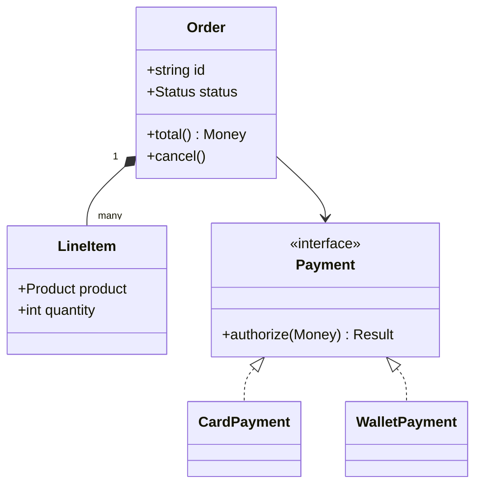

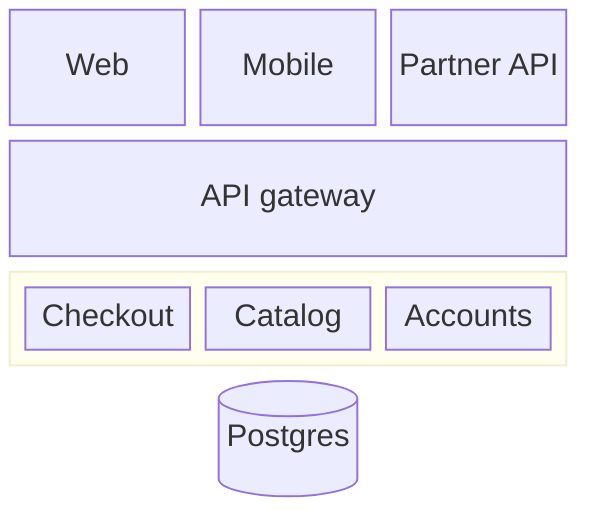

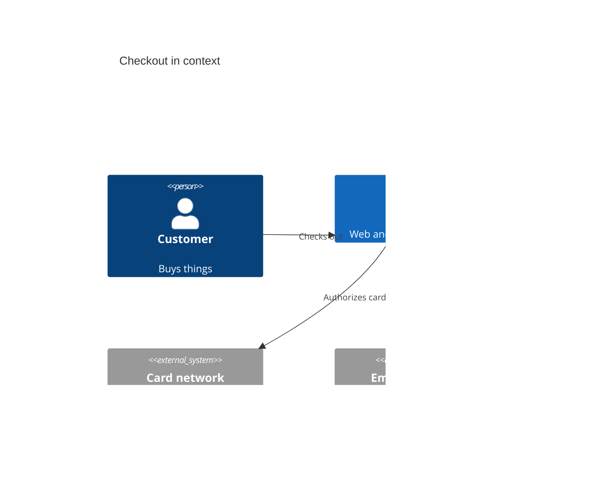

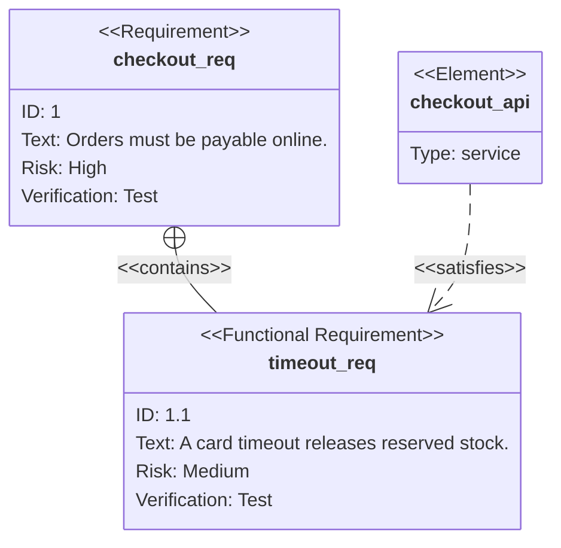

## Process

```mermaid
swimlane-beta LR
  subgraph Customer
    request[Report a wrong charge]
    receive[Get a refund]
  end

  subgraph Support
    triage[Triage]
    refund[Issue refund]
  end

  subgraph Payments
    investigate[Check the ledger]
  end

  request --> triage
  triage -->|Obvious| refund
  triage -->|Unclear| investigate
  investigate --> refund
  refund --> receive
```

```mermaid
agentflow-beta TB
  flow intake["Intake"]
    receive["Receive ticket"]@{ shape: input }
  end

  flow triage["Triage"]
    classify["Classify"]@{ shape: task }
    lookup["Look up order"]@{ shape: task }
    classify --> lookup
  end

  flow reply["Reply"]
    answer["Draft answer"]@{ shape: action }
  end

  receive --> classify
  lookup --> answer
```

```mermaid
usecase-beta
direction LR
actor Customer
actor Support
Browse("Browse catalog")
Checkout("Check out")
Refund("Request refund")
Customer --> Browse
Customer --> Checkout
Customer --> Refund
Support --> Refund
```

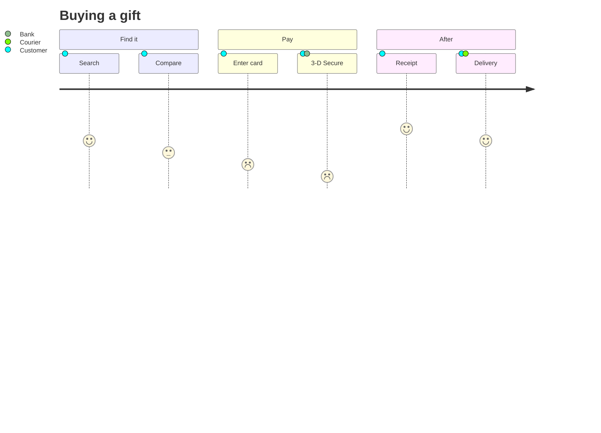

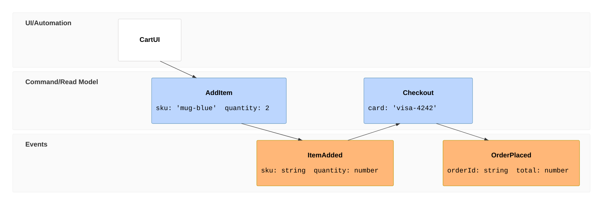

## Planning

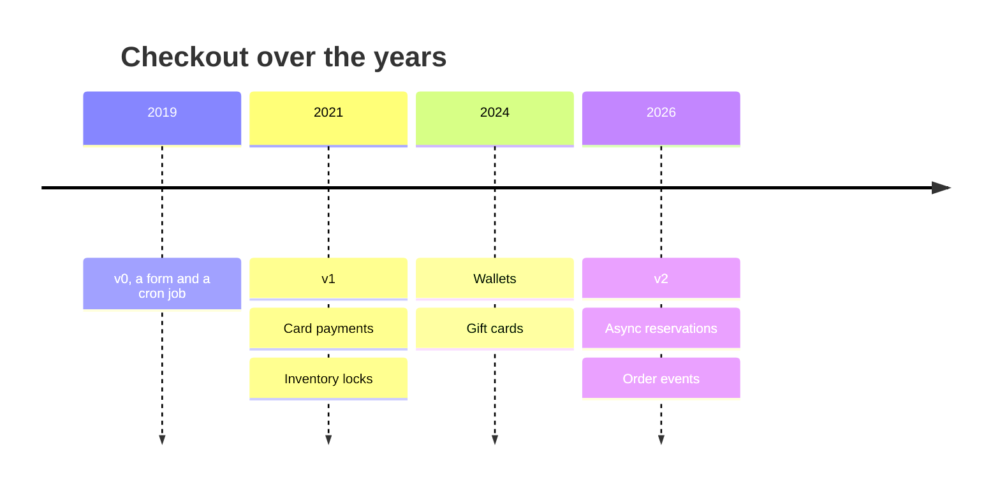

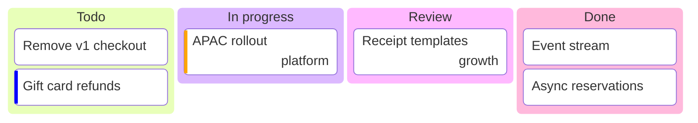

## Charts

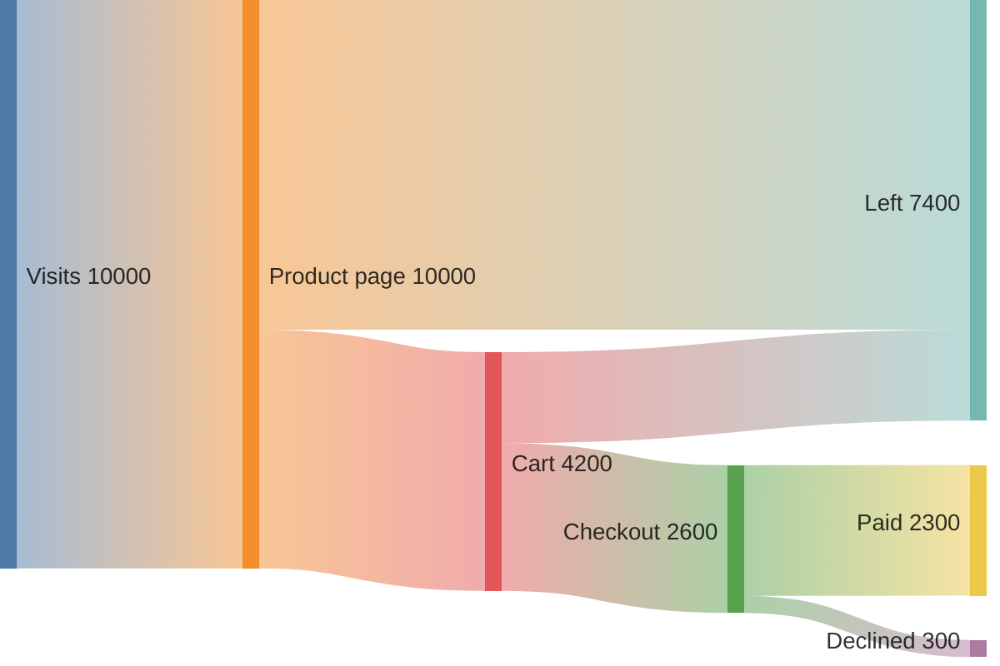

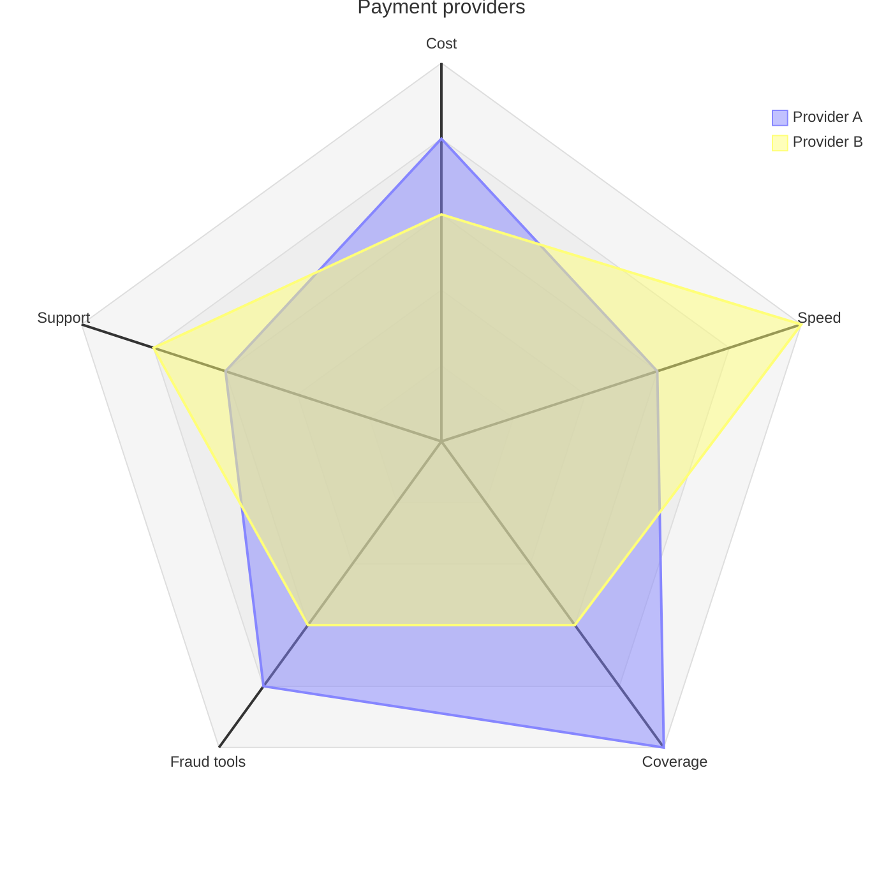

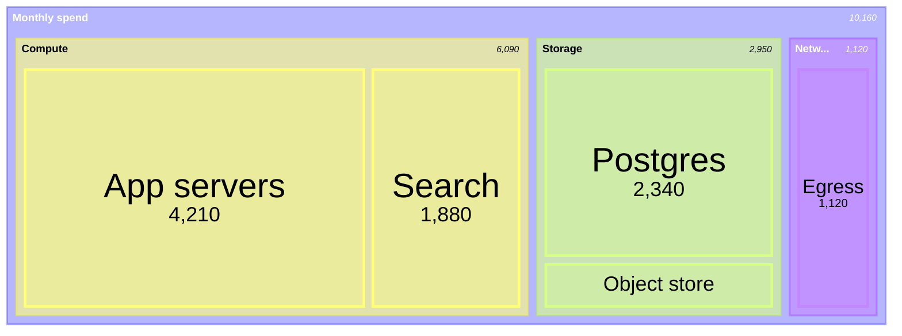

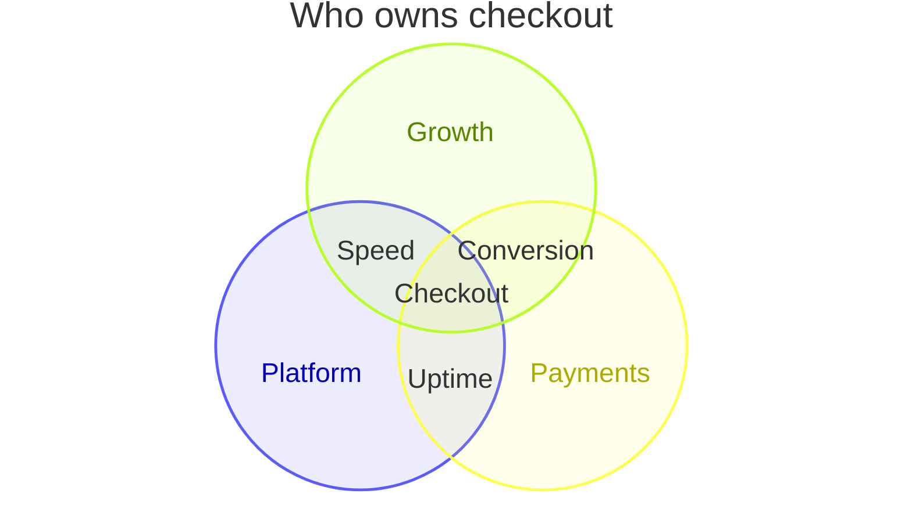

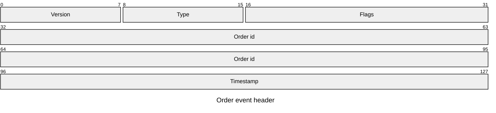

## Maps

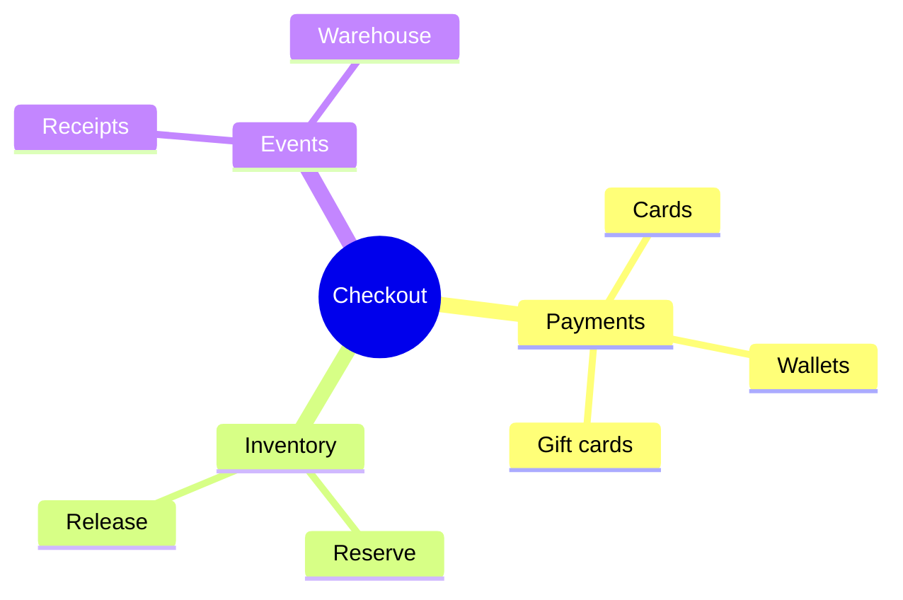


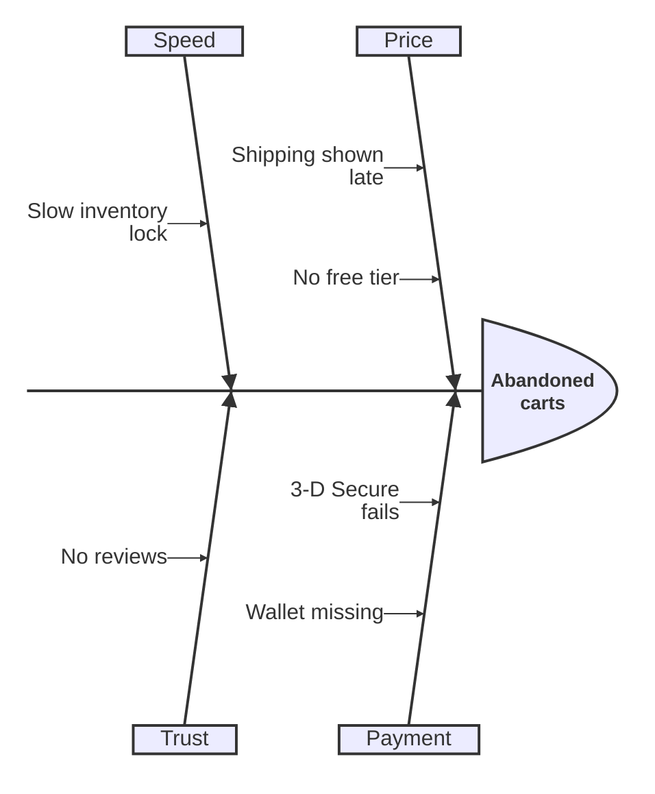

```mermaid
wardley-beta
title Checkout value chain

anchor Customer [0.95, 0.63]
component Checkout [0.79, 0.55]
component Payments [0.60, 0.75]
component Inventory [0.55, 0.45]
component Card network [0.35, 0.88]
component Compute [0.10, 0.85]

Customer -> Checkout
Checkout -> Payments
Checkout -> Inventory
Payments -> Card network
Inventory -> Compute

evolve Inventory 0.70
```

```mermaid
cynefin-beta
  title Checkout incidents

  complex
    "Fraud spikes"

  complicated
    "Slow card network"

  clear
    "Expired certificate"

  chaotic
    "Double charges"

  chaotic --> complex : "Stopped the bleeding"
  complex --> complicated : "Found the pattern"
  complicated --> clear : "Wrote the runbook"
```

```mermaid
railroad-ebnf-beta
title "Coupon code"

coupon = prefix "-" digits [ "-" suffix ] ;
prefix = "SAVE" | "GIFT" | "VIP" ;
digits = digit digit digit+ ;
suffix = "EU" | "US" ;
digit = "0" | "1" | "2" | "3" | "4" | "5" | "6" | "7" | "8" | "9" ;
```

## Fence props and errors

Props on the opening fence go to the component. `{.wide}` here adds a class
to the wrapper, which this site uses to let a diagram break out of the text
column:

```mermaid {.wide}
flowchart LR
  md[".md file"] --> parse["parseMarkdown()"]
  parse --> node["pele node"]
  node --> server["SVG on the server"]
  node --> browser["mount() in the browser"]
  browser --> fit["fits the width"]
  browser --> zoom["zoom when needed"]
```

A block Pele can't draw keeps its source, so a typo never takes the page down:

```mermaid
flowchart LR
  A --> B -->
```
