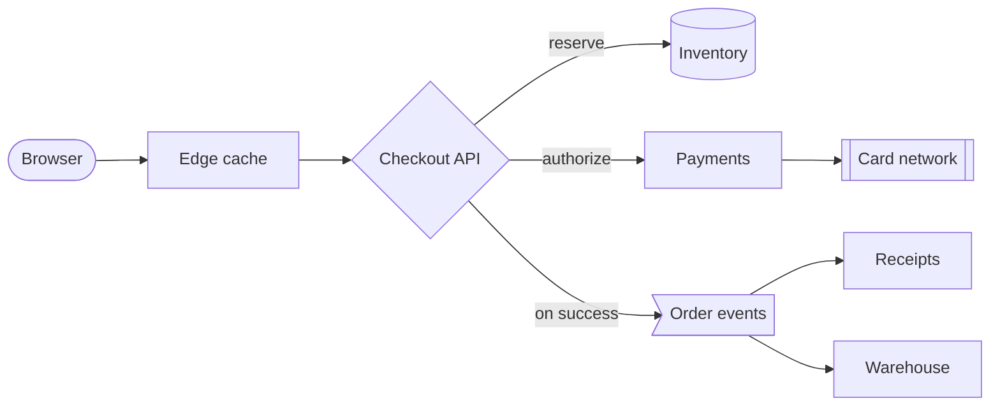
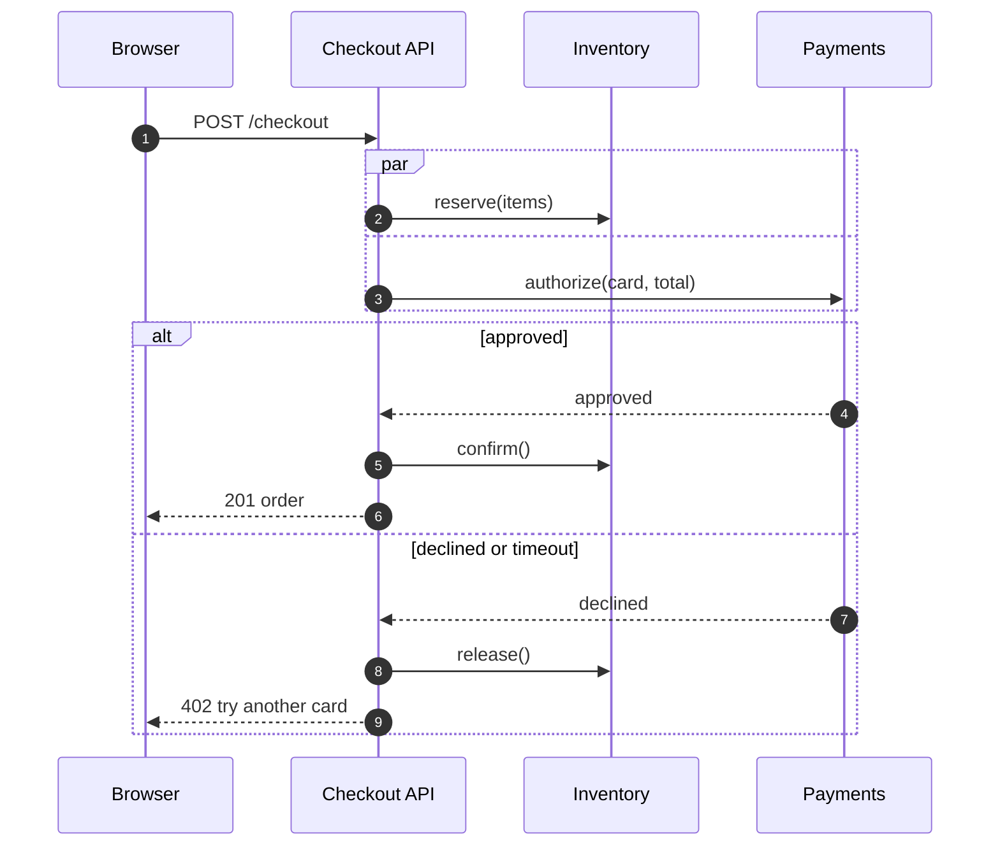
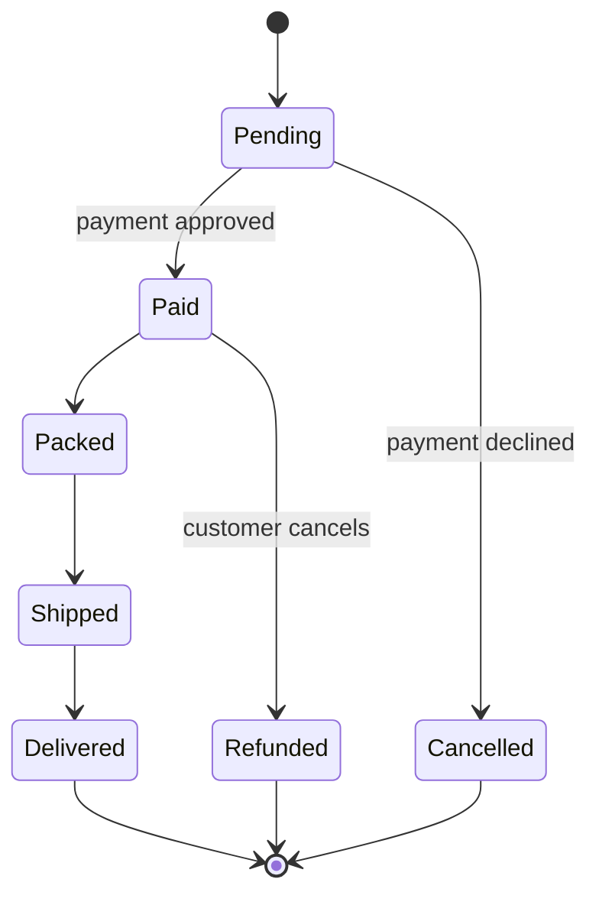
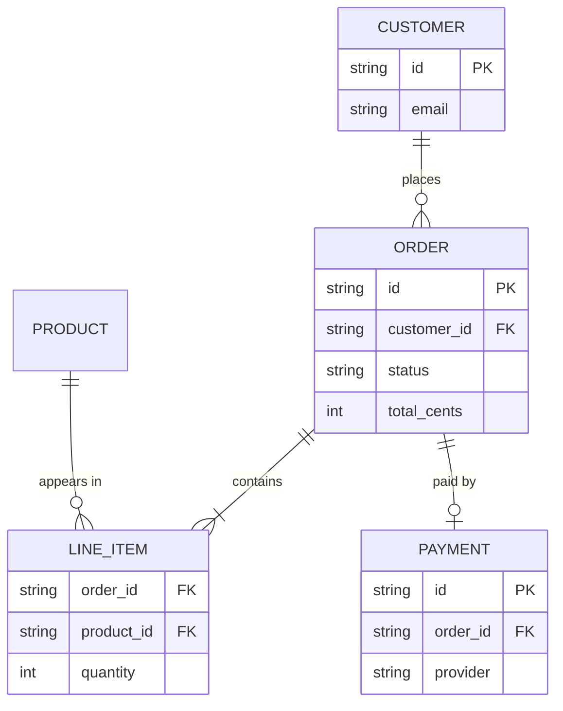
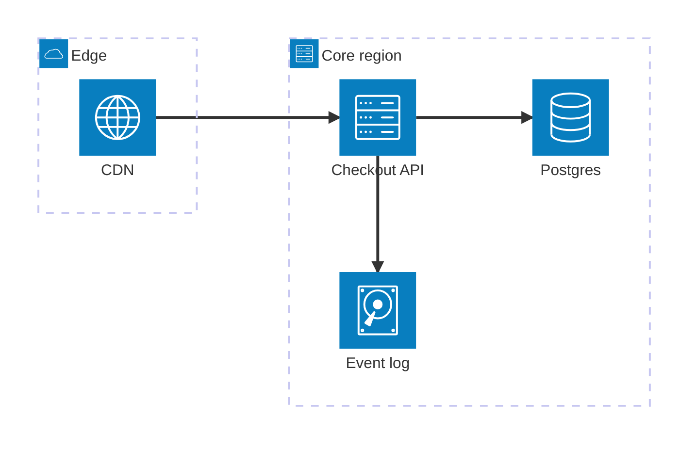
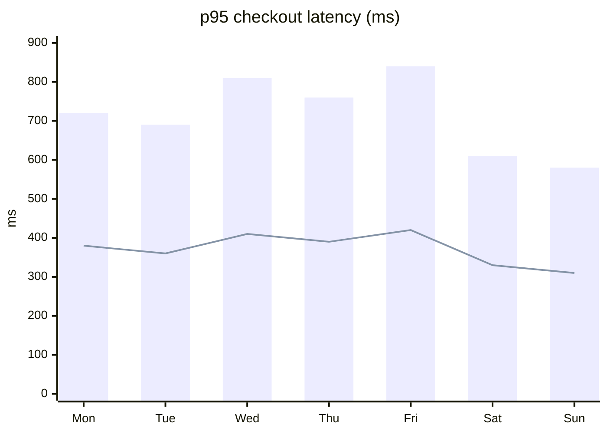
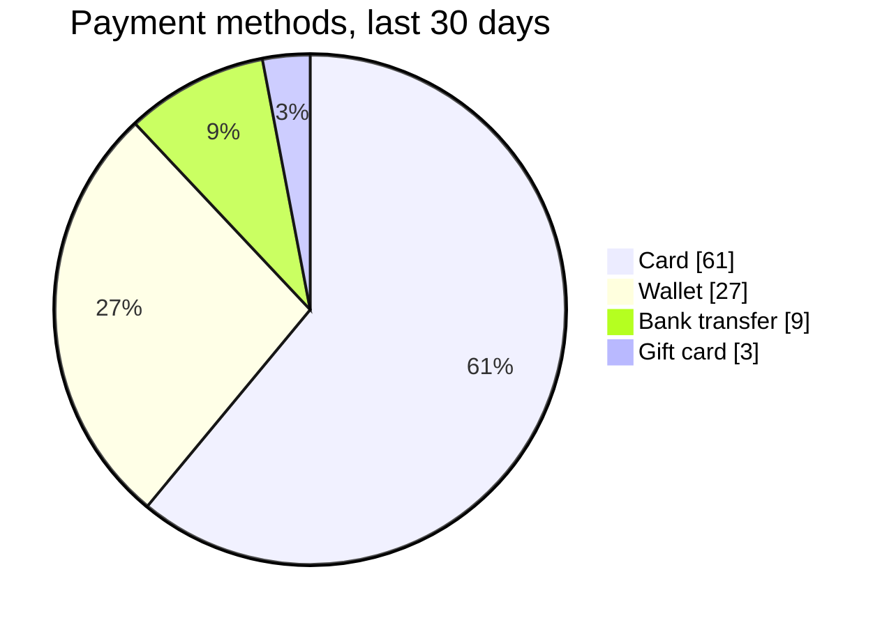
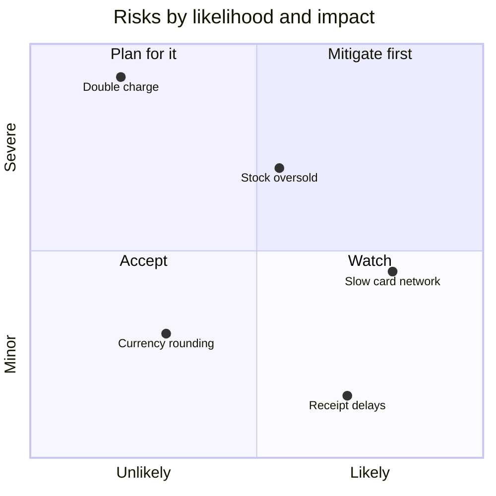
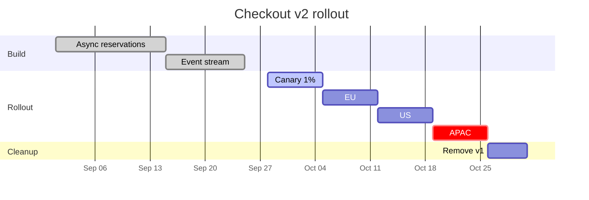
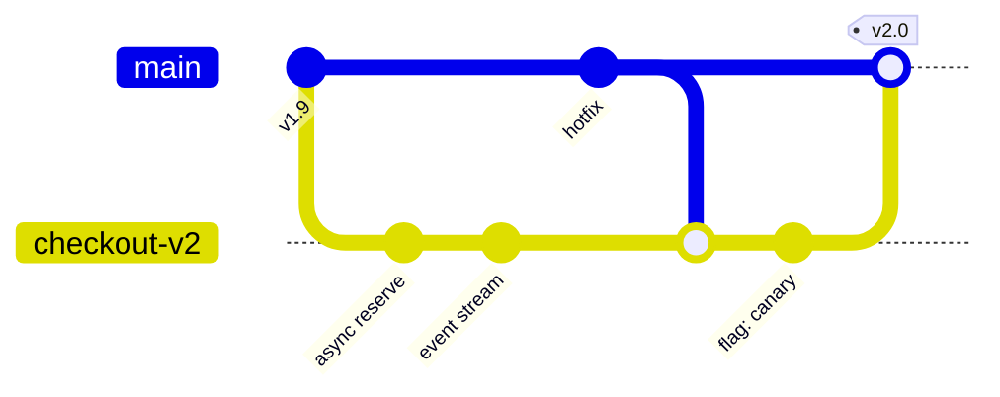

# Checkout v2 — design doc

This whole page is one Markdown file. The prose is CommonMark, and every
diagram in it is a plain ` ```mermaid ` code block. The
[comark-pele](https://github.com/farnabaz/comark-pele) plugin turns those
blocks into `pele` nodes while [Comark](https://comark.dev) parses the file,
and [Pele](https://pele.run) draws each one as SVG. The SVG is in the HTML the
server sends, so the diagrams show up before any JavaScript runs.

No MDX and no build step: the file is read and parsed on each request, so the
same code would serve Markdown from a database or a model.

## The request path

A checkout starts at the edge and goes to two services. Only the payment call
is on the critical path. Inventory is reserved at the same time and released
if the payment fails.



### Authorizing a card

The API holds the reservation until the card network answers, then confirms
or releases it. A timeout counts as a decline, so a slow network never leaves
stock reserved.



## The order lifecycle

An order is a small state machine. Every change is an event on the order
stream, so the warehouse and the receipts service never call the API.



### Data model



## Where it runs



## What we expect

v1 spends most of its time waiting on the inventory lock. Moving the
reservation off the critical path should take p95 under the 400 ms budget.



Bars are v1 in production last week, the line is v2 under replayed traffic.
Card payments are most of the volume, so they are what the canary watches.



### Risks



## Rollout

v2 ships behind a flag, one region at a time, with v1 kept warm until the
last region has run clean for a week.



Each stage merges to `main` behind its own flag, so a rollback is a flag
flip, not a revert.



---

Every diagram type Pele supports is on the [catalog](/catalog) page.
