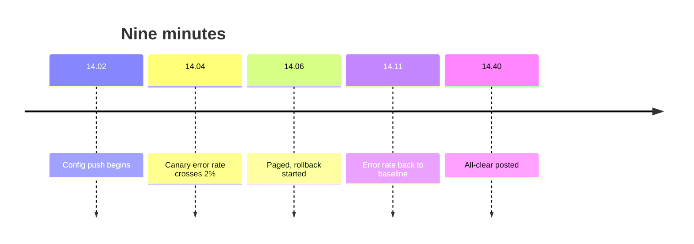
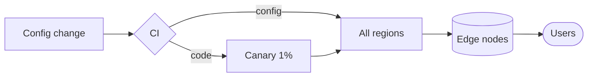
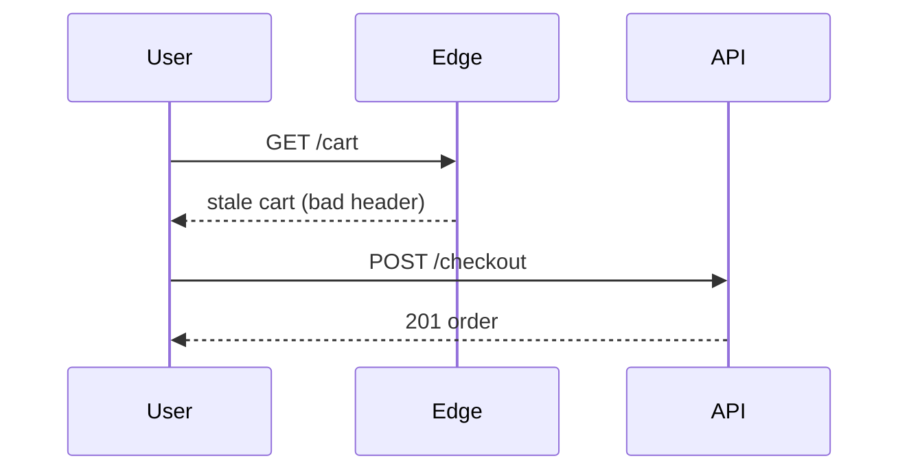
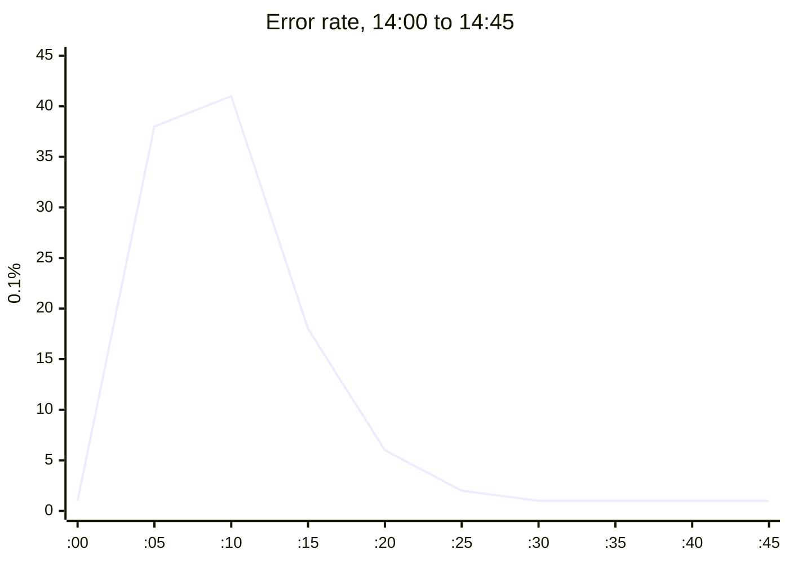
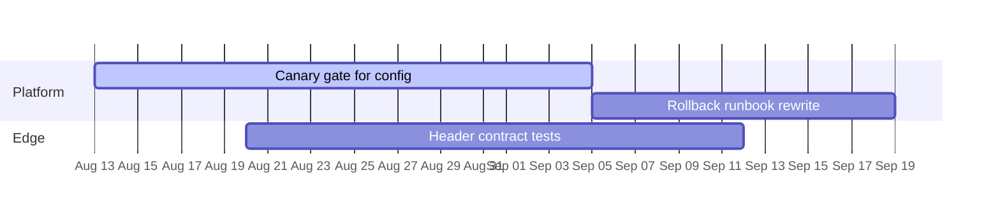

## Incident 4412: cache headers, 12 August

A config push at 14:02 UTC sent bad cache headers to two thirds of the edge
nodes. The canary caught it, and the rollback finished at 14:11.

The push skipped the canary gate because config changes went straight to
every region:

Reads degraded. Writes never did, because they bypass the edge cache:

Error rate over the window, in tenths of a percent:

## Follow-ups

Config now goes through the same canary gate as code. That one change would
have caught this before the push instead of after.

